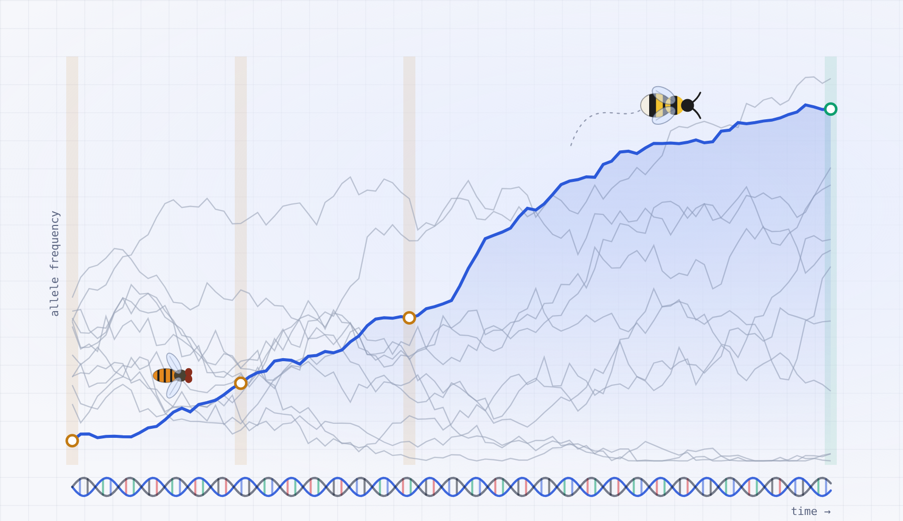

# SPOT: Selection Power Over Time

SPOT estimates the **power to detect selection at a candidate locus** from allele frequencies sampled at two or more dates: museum specimens and a modern sample, an ancient DNA series, or any time series of population samples. It simulates the population forward in time with selection, genetic drift and, optionally, migration and changes in population size, for haploid, diploid or haplodiploid inheritance. It then samples individuals and passes them through low-coverage sequencing and genotype calling, as in a real study.

Power is measured against a **drift-aware threshold**: the detection threshold is set from simulations without selection that include the drift, sampling and genotyping of the design, not from the standard normal distribution.

## Use it

- **Online:** <https://yacinebenchehida.github.io/SPOT-simulator/>
- **Offline:** the application is one self-contained file. Save the online page (File → Save page as), or open [`index.html`](index.html) here and click "Download raw file". Then open the file in any browser. No installation is needed, and everything runs on your own computer.

## Quick start

1. Describe the design: inheritance system, years per generation, sampling years and number of individuals at each date, sequencing depth, number of candidate loci.
2. Explore what is unknown (Ne, starting frequency p₀, selection coefficient s, dominance, year selection starts) with the **parameter power curve** and the **sample-size planner**, rather than guessing one value.
3. Read the main tile: power of the trend test with the drift-aware threshold.
4. For a final estimate, we recommend 5,000 selection simulations.

## What power means

Power is the probability that a sampling design detects selection when selection is acting. A power of 80% means that selection of the chosen strength is detected in 8 studies out of 10 and missed in 2. SPOT estimates it in five steps:

1. **Simulate** the population many times: by default 1,000 times with selection and 2,000 times without (neutral simulations).
2. **Sample and genotype** individuals at each date, with the sample sizes, read depths and error rates of the design.
3. **Score** each simulation with Z, the Cochran–Armitage trend score: the larger Z, the clearer the rise of the allele over time.
4. **Set the threshold** so that only 5% of the neutral simulations exceed it (the significance level α, divided by the number of candidate loci L).
5. **Count**: power is the proportion of selection simulations above the threshold.

A standard test ignores drift and sets the threshold too low, so it often finds selection where there is none. SPOT shows this as the false-positive rate of the sampling-only threshold.

## Documentation

- The [SPOT manual](SPOT_manual.md) explains how to use the application and how to read its results: every setting, step-by-step uses, interpretation, and questions and answers.
- The [explained guide](miscellaneous/simulations_explained.md) describes how the simulations work, step by step, with worked examples and real numbers, for readers who want to understand the method in more depth.

## How to cite

Please cite SPOT as:

> Ben Chehida, Y. et al. (2026). SPOT: Selection Power Over Time, version 0.9.2. https://github.com/yacinebenchehida/SPOT-simulator

## Licence

MIT; see [`LICENSE`](LICENSE).

## Questions and problems

Please open an [issue](https://github.com/yacinebenchehida/SPOT-simulator/issues) on GitHub.

## Repository contents

| File or folder | Content |
|---|---|
| `index.html` | The application. |
| `sim.js` | The simulation code used by the application. |
| `SPOT_manual.md` | The SPOT manual. |
| `miscellaneous/` | An explained guide to the simulations, written for teaching, with the scripts that reproduce its numbers. |
| `paper/` | Analyses and figures of the article, with the scripts that produce them. |
| `tests/` | Checks that the application runs exactly the simulation code in `sim.js`. |
