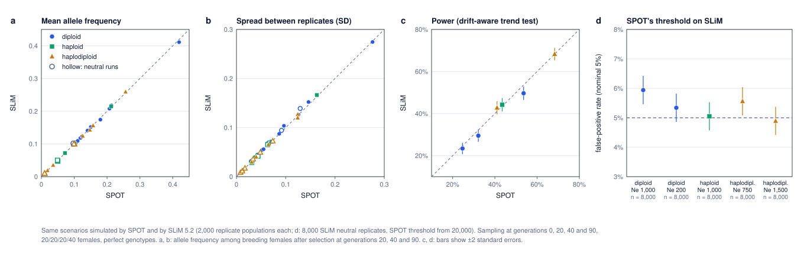

# Comparison with SLiM

## Why

SPOT simulates populations in a simplified, fast way: it follows allele frequencies rather than individuals, draws the genes of each generation's breeding adults as binomial samples, and draws sampled genotypes from the expected genotype frequencies. These shortcuts are standard for Wright–Fisher models, and SPOT already reproduces the theoretical results (see [`theory.md`](theory.md)). But theory covers only simple cases. Here the same scenarios are simulated by SLiM, a widely used, independently written, individual-based simulator. If SPOT's shortcuts or its code (including the haplodiploid case) were wrong, the two would disagree.

## Methods

**SLiM model** ([`slim_check.slim`](slim_check.slim), SLiM 5.2). One locus with two alleles in a Wright–Fisher population of fixed size, with no mutation or migration. Every individual is simulated, and parents are chosen in proportion to their fitness (SLiM's own fitness machinery). Three inheritance systems:

- **diploid**: Nf females and Nm males; fitness 1, 1 + hs and 1 + s for 0, 1 and 2 copies;
- **haploid**: N individuals reproducing clonally; fitness 1 or 1 + s;
- **haplodiploid**: diploid females and haploid males. SLiM has no built-in haplodiploidy, so each male carries two identical copies of his single maternal genome. A father then always passes on his one genome, and a son inherits only from his mother. The script explains this in detail.

The allele starts at frequency p₀ in each sex. Selection acts from generation 1 onwards, as in SPOT when selection starts at the first sampling date. 2,000 replicate populations are simulated per scenario, as separate subpopulations of one SLiM run.

**Design** (the default of the page): samples at generations 0, 20, 40 and 90 (1935, 1955, 1975, 2025 with one generation per year), 20/20/20/40 females, perfect genotypes. At each sampling generation, both simulators record two things:

- the allele frequency among breeding females after selection;
- the allele copies among the sampled females.

In SLiM, the sampled females are drawn from the actual population in proportion to their fitness.

**Scenarios** ([`slim_runs.sh`](slim_runs.sh)): six with selection, each with a matching neutral scenario.

| Scenario | System | Ne | p₀ | s | h |
|---|---|---|---|---|---|
| 1 | diploid | 1,000 | 0.1 | 0.02 | 0.5 |
| 2 | diploid | 1,000 | 0.1 | 0.05 | 0 (recessive) |
| 3 | diploid | 200 | 0.1 | 0.05 | 0.5 |
| 4 | haploid | 1,000 | 0.05 | 0.02 | – |
| 5 | haplodiploid | 750 | 0.1 | 0.02 | 0.5 |
| 6 | haplodiploid (bumblebee scenario of the page) | 1,500 | 0.01 | 0.05 | 0.5 |

SPOT simulated the same scenarios with the same number of replicates, using its own code ([`slim_compare.js`](slim_compare.js) calls `sim.js`). The outputs of both simulators were then analysed with the same code:

- **Allele frequencies.** The mean and SD across replicates at generations 20, 40 and 90, and a two-sample Kolmogorov–Smirnov test of the whole distribution at generation 90.
- **Power.** The trend test across the four dates, with each simulator's drift-aware threshold (the 95% quantile of its own neutral replicates), as in SPOT.
- **False-positive rate.** SPOT's threshold applied to SLiM's neutral populations. This is the most direct check: if SPOT simulates drift correctly, about 5% of SLiM's neutral populations should exceed SPOT's threshold. For this check, SPOT's threshold comes from 20,000 neutral replicates. Each of the five neutral scenarios was simulated with 8,000 SLiM replicates (four runs of 2,000 with different seeds), so that the false-positive rate is estimated with the same precision in all of them.

## Results



**Allele frequencies (panels a, b).** Mean frequencies agree within Monte Carlo error at every sampling date: across 33 comparisons the differences range from −1.4 to +2.2 standard errors. The spread between replicates agrees within 8% (SD ratio 0.93–1.08). At generation 90, the Kolmogorov–Smirnov test finds no difference between the two distributions in any scenario (all p > 0.15).

**Power (panel c).**

| Scenario | SPOT | SLiM | Difference (SE) |
|---|---|---|---|
| 1. diploid, Ne 1,000, s = 0.02 | 32.2% | 29.5% | +2.7 (1.5) |
| 2. diploid, Ne 1,000, s = 0.05, recessive | 24.7% | 23.4% | +1.3 (1.4) |
| 3. diploid, Ne 200, s = 0.05 | 53.6% | 49.7% | +4.0 (1.6) |
| 4. haploid, Ne 1,000, s = 0.02 | 43.5% | 44.2% | −0.8 (1.6) |
| 5. haplodiploid, Ne 750, s = 0.02 | 41.0% | 42.8% | −1.8 (1.6) |
| 6. haplodiploid, Ne 1,500, p₀ = 0.01, s = 0.05 (bumblebees) | 68.3% | 68.3% | 0.0 (1.5) |

**False-positive rate (panel d).** SPOT's threshold applied to SLiM's neutral populations:

| Neutral scenario | SLiM replicates | False-positive rate |
|---|---|---|
| diploid, Ne 1,000 | 8,000 | 5.9% (± 0.24) |
| diploid, Ne 200 | 8,000 | 5.3% (± 0.24) |
| haploid, Ne 1,000 | 8,000 | 5.1% (± 0.24) |
| haplodiploid, Ne 750 | 8,000 | 5.6% (± 0.24) |
| haplodiploid, Ne 1,500, p₀ = 0.01 | 8,000 | 4.9% (± 0.24) |

## Interpretation

SLiM and SPOT agree. Allele frequencies, power and the drift-aware threshold match for diploid, haploid and haplodiploid populations, including recessive selection, strong drift (Ne = 200) and the bumblebee scenario of the page. SPOT's shortcuts and its haplodiploid inheritance therefore give the same results as a full individual-based simulation.

One small, consistent difference remains. In two of the five neutral scenarios (diploid Ne = 1,000 and haplodiploid Ne = 750), SPOT's threshold lets through 5.6–5.9% of SLiM's neutral populations instead of 5%. That is 2–4 standard errors with 8,000 replicates. In the diploid runs, SLiM's allele frequencies are also slightly more variable (SD up to 8% larger at generation 90). As a result, SLiM's power is 1–4 points lower than SPOT's in the diploid scenarios. We have not identified the cause: SPOT's own drift matches the theoretical loss of heterozygosity within 0.4% ([`theory.md`](theory.md)), and both programs implement the same Wright–Fisher model.

In practice, SPOT's false-positive rate may be about one percentage point above the nominal 5% for real populations behaving like SLiM's. That is far smaller than the excess of the naive test, which ignores drift (often 10–20% in comparable designs; see [`false_positive_rate.md`](false_positive_rate.md)).

**Limits.** Only one locus, one sampling design and Wright–Fisher populations were compared. Sequencing depth and genotype errors were switched off: they are applied in the same way to both simulators' samples, so they cannot cause a difference between them. Rescaling (very long series) was not compared with SLiM; it is checked against SPOT's full simulation in [`rescaling.md`](rescaling.md).

## Files and how to reproduce

| File | Content |
|---|---|
| `slim_check.slim` | The SLiM model, with comments explaining every step. |
| `slim_runs.sh` | Runs all SLiM scenarios (list and parameters at the top of the file). |
| `slim_compare.js` | Simulates the same scenarios with SPOT and compares the two. |
| `slim_figure.py` | Draws `slim_check.svg`. |
| `slim_results.tsv` | Allele frequencies: mean and SD for SPOT and SLiM, z-scores, KS tests. |
| `slim_power.tsv` | Power and thresholds for SPOT and SLiM. |
| `slim_fpr.tsv` | False-positive rate of SPOT's threshold on SLiM's neutral populations. |

Requires SLiM 5 ([messerlab.org/slim](https://messerlab.org/slim/); tested with version 5.2), Node.js and Python 3. Run from the repository root:

```
bash validation/slim_runs.sh          # SLiM runs, about 20 minutes; raw output in validation/slim_out/ (not in the repository)
node validation/slim_compare.js       # SPOT runs and comparison, about 1 minute
python3 validation/slim_figure.py
```

If SLiM is not on the PATH, give its location: `SLIM=/path/to/slim bash validation/slim_runs.sh`.
