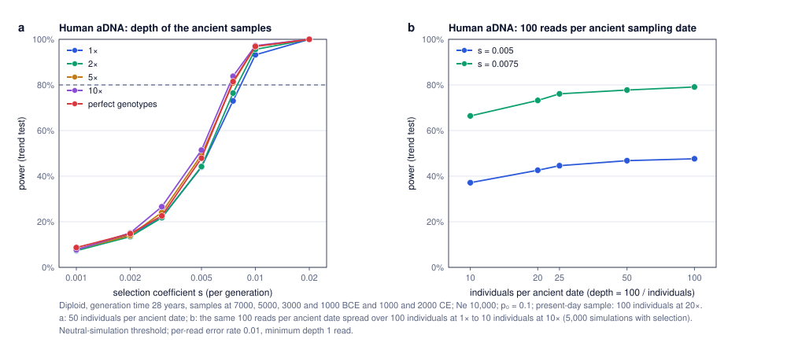

# Worked examples

These examples show what SPOT tells a user who is planning a study. The main example uses the bumblebee scenario of the page; three shorter examples show different situations: a long-lived mammal, a bacterial pathogen sampled over many generations, and human ancient DNA sequenced at low depth. They are written so they can be adapted for the application section of the paper.

All results use the drift-aware trend test across all sampling dates at α = 0.05 (one locus), unless stated. Each power value comes from 1,000 replicates under selection (5,000 for panel d, 500 for the pathogen), so values vary between runs by about 1.5 percentage points (see [`../validation/monte_carlo_precision.md`](../validation/monte_carlo_precision.md)). Differences of 1–3 points are therefore within noise.

## 1. Main example: museum bumblebees

**Why.** Museum collections give a few dated samples spread over a century, often with small numbers and low-quality DNA. Before sequencing, a researcher wants to know which strengths of selection could be detected, and whether money is better spent on more historical specimens, more modern ones, or deeper sequencing.

**Design.** Haplodiploid, Nf = Nm = 1,000 breeding females and males (Ne = 1,500), one generation per year. Females sampled in 1935, 1955, 1975 and 2025 (20/20/20/40), sequenced at 10× (historical) and 15× (modern), error rate 0.005. Selection starts in 1935.


**a. Which selection can be detected.** Power depends strongly on the starting frequency of the allele:

| Starting frequency p₀ | s for 80% power | Power at s = 0.01 |
|---|---|---|
| 0.01 (rare) | about 0.065 | 11% |
| 0.05 | about 0.035 | 12% |
| 0.1 | about 0.025 | 21% |
| 0.3 | about 0.02 | 33% |

Weak selection (s ≤ 0.01) is not detectable with this design whatever the starting frequency. A rare allele needs selection about three times stronger than a common one.

**b. Anchoring Ne, and its effect on power.** Ne is usually the least known parameter. It can be anchored on the heterozygosity lost between the first and last samples, which SPOT reports for each scenario: retaining 86%, 94% or 97% of the 1935 heterozygosity in 2025 corresponds to Ne ≈ 300, 750 or 1,500. With s = 0.05 and p₀ = 0.1, power is above 98% for Ne ≥ 750, 83% at Ne = 300 and 64% at Ne = 150. At Ne = 150, five times more samples (100/100/100/200) raise power only from 64% to 67%: drift, not sampling, limits detection.

**c. The naive test is misleading at the same time.** The naive test (which ignores drift) rejects 19% of neutral loci at Ne = 150–300 with the reference samples, and up to 29% with five times more samples. Larger samples make the naive test more confident about changes that are only drift; the drift-aware threshold keeps the false-positive rate at 5%.

**d. Where to add effort, and when it pays off.** Four options were compared with the reference design (100 individuals): adding 60 historical or 60 modern individuals, doubling historical depth, or moving the same 100 individuals to the first and last dates only. They were tested in two situations: the bumblebee population (Ne = 1,500, strong drift over 90 generations) and a much larger one (Ne = 100,000, weak drift). In each, s was chosen so that the reference design has 55–67% power, and each value uses 5,000 replicates (a difference between two options is precise to about 1 point). Gain in power over the reference, in percentage points (range over p₀ = 0.01, 0.1 and 0.3):

| Option | Ne = 1,500 | Ne = 100,000 |
|---|---|---|
| +60 historical: 40/40/40/40 | +2 to +5 | +11 |
| +60 modern: 20/20/20/100 | +2 to +6 | +13 to +22 |
| Historical depth 20× instead of 10× | −2 to 0 | 0 to +2 |
| Same 100 individuals at first and last dates only (50/50) | 0 to +6 | +12 to +16 |

With strong drift, extra effort gains at most 6 points: the population's own random changes, not sampling error, limit detection. With weak drift, the same effort gains 11–22 points, because sampling error is then the main source of noise. In both situations, modern specimens help at least as much as historical ones (and are usually cheaper), and doubling the depth of historical samples does not help, because 10× already calls most genotypes correctly. Concentrating samples at the first and last dates is as good as or better than spreading them over four dates, because with selection that started at the first date the frequency change is largest between the two ends.

**Take-home.** In this scenario, the biology sets the limits more than the sampling: selection of s ≥ 0.03 on an allele at 10% or more is detectable with the existing 100 specimens, a rare allele needs s ≥ 0.07, and if Ne is below about 300 no affordable increase in sample size reaches 80% power. Whether extra sampling pays off depends on drift: little for this population (at most 6 points), much more for a large one (up to 22 points); when it does, modern specimens are the best investment. For alleles that are not rare (p₀ ≥ 0.05), ignoring drift would give 2–6 times too many false positives.

## 2. Contrasting example: a long-lived mammal

**Why.** For species with long generation times, a century of samples covers only a few generations, and populations have often gone through recent bottlenecks.

**Design.** Diploid, generation time 20 years, samples in 1880, 1950 and 2020 (20/20/40), historical depth 4×, p₀ = 0.1. Ne is 5,000 before 1950 and either stays at 5,000, drops to 200, or drops to 50 after 1950 (entered as Ne per interval).


**Results (panel a).** The 140 years cover only 7 generations, so selection must be very strong to be detected: with constant Ne, power is 28% at s = 0.2, 50% at s = 0.3 and 86% at s = 0.5. A bottleneck to Ne = 200 changes little (82% at s = 0.5). A severe bottleneck to Ne = 50 lowers power to 64% at s = 0.5, and raises the naive test's false-positive rate from 4% to 9%.

**Interpretation.** The number of generations, not the number of years, limits power. For long-lived species, only strong selection (about s ≥ 0.45 per generation for 80% power) is within reach of a museum time series, and a severe recent bottleneck makes both detection harder and the naive test less reliable.

## 3. Optional example: a bacterial pathogen

**Why.** Historical DNA of bacteria and viruses spans thousands of generations, more than most simulators handle quickly. SPOT rescales such series automatically (see [`../validation/rescaling.md`](../validation/rescaling.md)).

**Design.** Haploid, 100 generations per year, N = 100,000, samples in 1850, 1900, 1950, 2000 and 2020 (10/10/15/20/40), p₀ = 0.05. The 170 years correspond to 17,000 generations.

**Results (panel b).** Power is 27% at s = 0.0001 per generation, 71% at s = 0.0002 and 99% at s = 0.0005 (that is, 1%, 2% and 5% per year). The naive test rejects 9% of neutral loci: over 17,000 generations, drift matters even with N = 100,000.

**Interpretation.** Selection that is very weak per generation becomes detectable over thousands of generations, so pathogen time series can reveal selection far weaker than in animals sampled over the same period.

## 4. Human ancient DNA: depth against number of individuals

**Why.** Ancient DNA is often sequenced at 1–2×. With a fixed sequencing effort, is it better to sequence many individuals at low depth or fewer at higher depth?

**Design.** The "Human ancient DNA" example scenario of the page: diploid, 28 years per generation, samples at 7000, 5000, 3000 and 1000 BCE and 1000 and 2000 CE (321 generations), 50 individuals per ancient date at 2× and 100 present-day individuals at 20×, Ne = 10,000, p₀ = 0.1, per-read error rate 0.01, minimum depth 1 read.



**Results.** (a) The depth of the ancient samples changes power little: at s = 0.005, power is 44% at 1× and 2×, 49% at 5× and 51% at 10× (48% with perfect genotypes); about s = 0.0075–0.01 is needed for 80% power at all depths. (b) With the same 100 reads per ancient date, more individuals at lower depth give more power: at s = 0.0075, 66% with 10 individuals at 10×, 76% with 25 at 4× and 79% with 100 at 1× (5,000 replicates under selection). The naive test rejects 14% of neutral loci with 100 individuals at 1× and 6% with 10 at 10×.

**Interpretation.** For a design like this one, sampling error (number of individuals) limits power more than genotype-call error, so spreading reads over more individuals pays off. SPOT calls diploid genotypes by maximum likelihood; pseudo-haploid calls (one random read per individual), common in human aDNA, are not modelled.

## Files and how to reproduce

| File | Content |
|---|---|
| `worked_examples.js` | All simulations (parts A–G); uses `../sim.js`, the same code as the page. |
| `bee_s_p0.tsv` | Bumblebees: power against s for four starting frequencies (A). |
| `bee_allocation.tsv` | Bumblebees: where to add samples, at Ne = 1,500 and Ne = 100,000 (B, 5,000 replicates). |
| `bee_ne.tsv` | Bumblebees: power and naive false-positive rate against Ne for 1×, 2× and 5× the samples, with the heterozygosity retained (C). |
| `mammal.tsv` | Long-lived mammal with and without bottleneck (D). |
| `pathogen.tsv` | Bacterial pathogen (E). |
| `human_depth.tsv` | Human ancient DNA: power against s for several depths of the ancient samples (F). |
| `human_budget.tsv` | Human ancient DNA: 100 reads per ancient date over 10 to 100 individuals (G, 5,000 replicates). |
| `figures.py` | Draws `bumblebees.svg`, `contrasts.svg` and `human_adna.svg` (Python standard library; uses `../validation/svgplot.py`). |

Run from the repository root (about 3 minutes in total):

```
node worked_examples/worked_examples.js A > worked_examples/bee_s_p0.tsv
node worked_examples/worked_examples.js B > worked_examples/bee_allocation.tsv
node worked_examples/worked_examples.js C > worked_examples/bee_ne.tsv
node worked_examples/worked_examples.js D > worked_examples/mammal.tsv
node worked_examples/worked_examples.js E > worked_examples/pathogen.tsv
node worked_examples/worked_examples.js F > worked_examples/human_depth.tsv
node worked_examples/worked_examples.js G > worked_examples/human_budget.tsv
python3 worked_examples/figures.py
```

Every scenario can also be reproduced on the page: choose the example scenario and change the values listed above.
